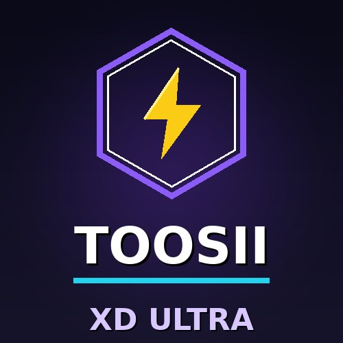

<div align="center">



# ᴛᴏᴏsɪɪ-xᴅ-ᴜʟᴛʀᴀ

**The official launcher for the TOOSII-XD-ULTRA WhatsApp bot — one command, always up to date.**

`WhatsApp Bot` · `Baileys` · `Node.js 20+` · `Multi-Device` · `Self-Hosted`

[](#-deploy)
[](#-deploy)
[](#-deploy)
[](https://www.toosiitech.org/)

</div>

---

## ✨ What is this repo?

This is the **deployment launcher** for TOOSII-XD-ULTRA. Instead of downloading the full bot source, you deploy this lightweight launcher — it does the rest:

- 📡 **Fetches the latest runtime** from the Toosii Tech distribution API on every start
- 🔄 **Self-updating** — new bot versions arrive automatically, no manual redeploys
- 🔐 **Keeps your data safe** — session, `.env`, data and logs survive every update untouched
- ⚡ **One command to run** — `node index.js` (or `node launcher.js` — both work)

> 💡 The launcher pairs with the [Session Generator](https://toosiitechdevelopertools.zone.id/session) — pair your WhatsApp account in the browser and paste the `TOOSII-XD:...` string into `.env`.

---

## 🚀 Deploy

1. **Upload** this repo as a ZIP to your hosting panel (KataBump, Render, Koyeb, Railway, Heroku, a VPS, or Termux)
2. **Edit the included `.env`** — fill in `OWNER_NUMBER` (+ `SESSION_ID`, or leave empty to pair via console code)
3. **Install & start:**
   ```bash
   npm run deploy
   ```
4. **Pair** — enter the pairing code shown in the console on your phone via **WhatsApp → Linked devices → Link with phone number**

**Panel start command:** `node index.js` (or `npm start`). If your panel auto-detects the entry file, either `index.js` or `launcher.js` works — they're the same bot.

The bot starts and stays current from here on — the launcher handles the rest.

---

## 💬 Commands

**484 commands across 15 categories** — downloads, AI, group moderation, stickers, games, economy, guards and more.

Run `.menu` inside WhatsApp to see the full, always-current list.

| Category | Highlights |
|---|---|
| ⬇️ Downloads | `.play`, `.ytv`, TikTok, Instagram, MediaFire |
| 🤖 AI | `.ai`, `.gpt`, `.gemini`, `.deepseek` |
| 🛡️ Guards | Anti-link, anti-spam, anti-badword, anti-delete |
| 👑 Groups | `.ban`, `.warn`, `.hidetag`, `.poll`, welcome/goodbye |
| 🎨 Media | Sticker packs, logo maker, audio FX |
| 🎮 Fun | Wordle, blackjack, slots, wallets & leaderboards |

---

<div align="center">

### ⭐ Support the project

If TOOSII-XD-ULTRA helps you, **star this repo** — it genuinely helps others find it.

**🌐 [toosiitech.org](https://www.toosiitech.org/)** · Session generator: [toosiitechdevelopertools.zone.id/session](https://toosiitechdevelopertools.zone.id/session)

</div>
